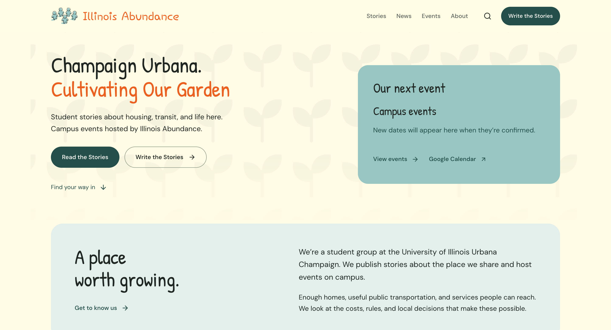
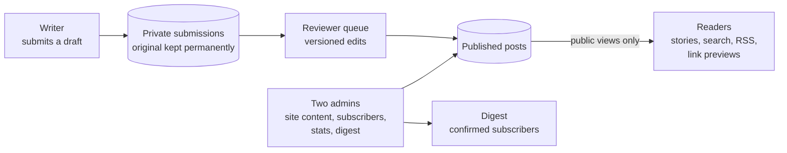

# Illinois Abundance

**The publishing site for Illinois Abundance, a student group at the University of Illinois Urbana-Champaign: students submit stories about housing and transit, a student reviewer edits them with the writer, and the group runs its events, news links, and email digest from one admin workspace.**

**[Visit it → abundance.bhanusadhu.com](https://abundance.bhanusadhu.com)** (public, no sign-up to read)



## The problem

A student group that wants to publish its members' writing usually has a shared document, an inbox of drafts, and a social account. Drafts get lost, edits happen in comment threads, nobody is sure what the writer originally sent, and the group's events and mailing list live in three other places. Anyone who volunteers to run it also becomes the person who can lose or leak everyone's drafts.

**Goal: let any student send a draft, get it edited by another student, and publish under their own name, while the group runs everything else from one place and never holds more private data than it needs.**

## How it works

1. **Write.** A student sends a draft from the site. The original is stored privately and permanently.
2. **Review.** A student reviewer claims the draft and edits it in a reviewer queue. Every save carries the revision number it started from, so two people editing at once cannot overwrite each other.
3. **Publish.** The reviewer publishes it under the writer's name. Photos are optional and are re-encoded on upload.
4. **Read.** Stories are searchable, grouped by topic, and available as an RSS feed. Each story gets a branded link preview.
5. **Keep up.** Readers can add events to Google Calendar, follow curated local news links, and subscribe to a digest with a confirmation email.
6. **Run it.** Up to two named admins edit the site's wording, manage reviewers, subscribers, and statistics, and send the digest by hand.

## Product decisions

| Decision | Trade-off |
| --- | --- |
| The writer's original is permanent and separate from the edited version. | More tables and a stricter schema. In exchange, a writer can always see what they sent, and an edit can never destroy it. |
| Edits are checked against a revision number and a conflict returns the current version. | A reviewer sometimes has to re-apply a change. A silent overwrite of someone's edit is worse. |
| The news section links out with the group's own title and summary, with no copied text or photos. | Less content on the page. A [source review](docs/news-source-review.md) records each publisher's terms and why this approach was chosen. |
| Subscribers are stored as an email, a confirmation time, and an opaque token, with double opt-in. | No profiles or tracking. The group learns almost nothing about readers. |
| The digest is sent by a person, not on a schedule. | More work each send. A person sees what is going out, and the send is deduplicated and resumable. |
| Only two named admins can change site settings, and reviewer permissions are re-checked in the database. | Handing over the site means changing two settings. A bug in one screen cannot give someone else admin. |
| Sample writing is clearly marked and can be turned off with one setting before launch. | An empty-looking site on day one, in exchange for never presenting fake stories as real ones. |

## Architecture



One Next.js app on Vercel with a serverless Postgres database. Pages read only from views that expose published content. Writes go through database functions that check who is acting and which revision they started from, so the rules hold even if a screen has a bug. Uploaded photos go to a private blob store and are served back through the site, never by a public bucket link.

## Hard problems

**Two people editing the same story.** The reviewer queue passes the revision it loaded into `review_post`, a database function that locks the row, compares versions, and returns a conflict with the current version instead of saving. The tests assert that a concurrent edit is never overwritten ([tests/review-api.test.ts](tests/review-api.test.ts), [db/migrations](db/migrations)).

**Keeping drafts private and originals permanent.** Private submissions live in their own table. Public pages read through views that expose only published fields, and truncating the originals table is blocked by a trigger, so even a mistaken admin script cannot wipe what writers sent ([hardening migration](db/migrations/202610120003_hardening.sql)).

**Uploads from strangers.** Photos are re-encoded, stripped of metadata, and bounded in size. SVGs disguised as images, missing alt text, oversized files, unsafe file paths, and unauthenticated uploads are all rejected, and an unpublished cover is never served to the public ([src/lib/image-upload.ts](src/lib/image-upload.ts)).

**Sending a digest exactly once.** Each digest run takes a lease, records the window it covers, and is deduplicated by date and a hash of its content, so a double click or a retry cannot email subscribers twice. A run that stops partway can be resumed ([src/lib/digest.ts](src/lib/digest.ts)).

## Results

- **211 tests pass** across 26 files (`npm test`, run for this README). They cover the database security rules against an in-process Postgres, the reviewer and admin permissions, cross-origin and unauthenticated writes, upload handling, email, event links, and the public pages.
- **Lint and typecheck are clean** (`npm run lint`, `npm run typecheck`).
- **Public pages are tested to hide what they should.** Tests check that an anonymous visitor cannot fetch an unpublished cover and that hidden topics stay out of the directory.

**Not measured yet.** The browser tests in [tests/browser](tests/browser) exist but were not run for this README. There are no performance, accessibility-audit, or load numbers, and no reader or writer analytics are reported here. The full check (`npm run check`: lint, typecheck, tests, production build) passes on Next.js 16.4.6.

## How it was built

1. **A private schema first.** Roles, the submissions schema, public projections, and Postgres security tests came before most screens.
2. **The editing desk.** A reviewer queue with revision conflict handling, then an admin workspace for content, subscribers, statistics, and exports.
3. **Email and sharing.** Double opt-in subscriptions, a resumable manual digest, and branded link previews generated from published content.
4. **Operations.** Deployment, editorial operations, and handover were documented, and two admins were supported with reviewer permission boundaries verified.
5. **A look of its own.** The first editorial layout was replaced with a warm ivory palette, handwriting-style headings matched to the logo, and a handwriting entrance for the home title. Instagram cards were dropped.
6. **Polish and accessibility.** Forms, motion, navigation, draft protection, photo previews, recovery from service failures, and event locations linked to Maps.

## Tech stack

| Layer | Technology |
| --- | --- |
| Frontend | Next.js 16 (App Router), React 19, TypeScript, Tailwind CSS v4 |
| Database | Serverless Postgres on Neon, with row-level security and security-barrier views |
| Storage | Vercel Blob (private store), `sharp` for re-encoding |
| Email | Resend |
| Calendar and links | `node-ical`, Google Calendar and Meet links |
| Testing | Vitest with PGlite, Playwright, axe-core |
| Hosting | Vercel |

## Run it locally

```bash
npm install
cp .env.example .env.local     # fill in the database, blob, mail, and secret values
npm run migrate                # apply the SQL migrations
npm run seed                   # sample writing, clearly marked
npm run dev                    # http://localhost:3000
npm run check                  # lint, typecheck, tests, and a production build
npm run test:browser           # Playwright
```

The tests use an in-process Postgres, so `npm test` needs no database or keys. Every variable is documented in [.env.example](.env.example).

## Project structure

```
src/app/          Routes: stories, news, events, write, review, admin, search, RSS, API
src/components/   Shared UI, plus the admin and reviewer screens
src/lib/          Submissions, review, digest, subscriptions, uploads, email, content
db/migrations/    The SQL schema, security rules, and database functions
scripts/          Migrate, seed, admin setup, brand asset and email preview tools
tests/            Unit and database security tests, plus Playwright specs
docs/             The news source review
```

## What's next

**Known limits.** The browser tests have not been run for this README, and `npm audit` still reports high-severity advisories in transitive dependencies (the blob client, `undici`, `zod`) that need a breaking upgrade. News links are curated by hand, and the digest is sent by hand.

**Next.** Clear the remaining dependency advisories, run the browser tests and an accessibility audit, and measure how long a story takes from draft to publish.
